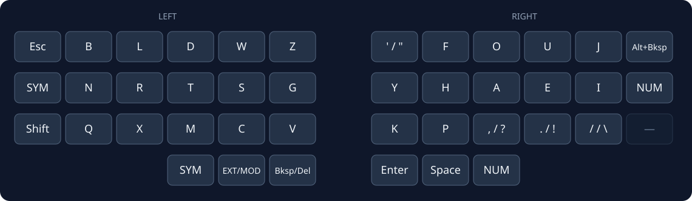
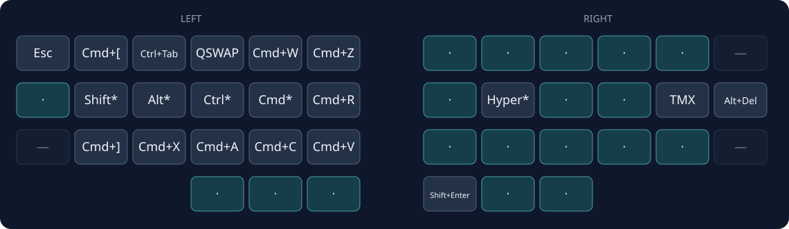
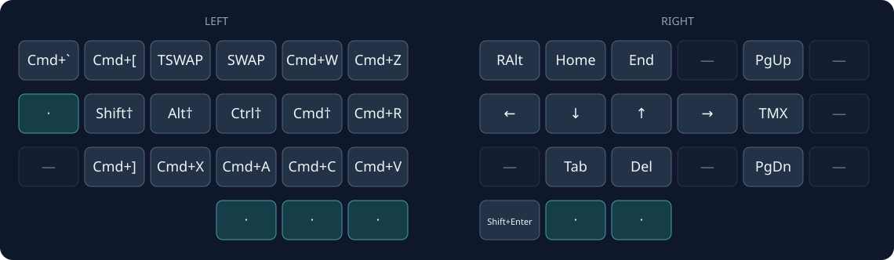
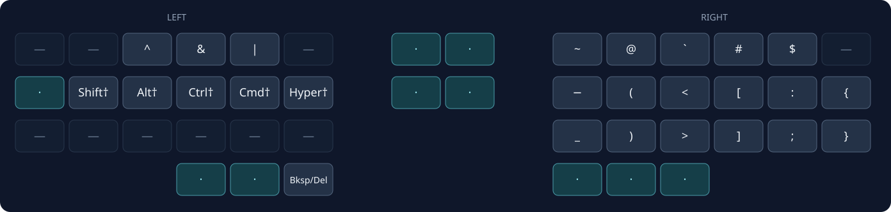
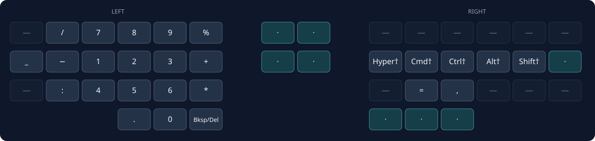
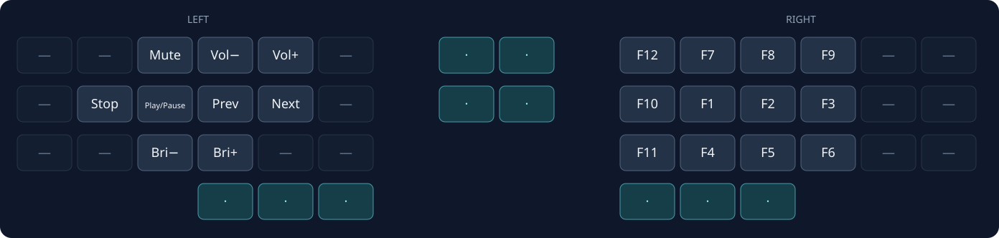
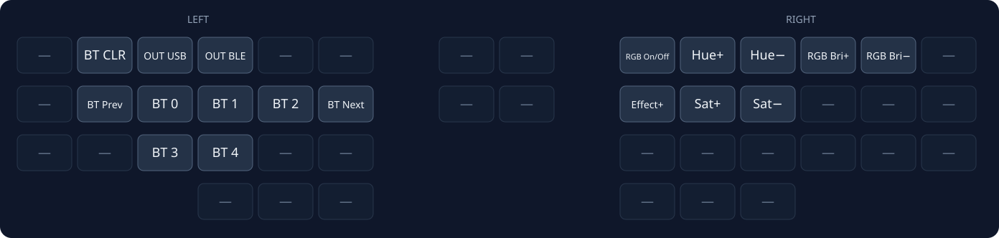

# Corne Choc Pro Layout

Personal ZMK firmware configuration for the Corne Choc Pro split keyboard.

Inspired by [Seniply](https://stevep99.github.io/seniply/) and [Callum](https://github.com/callum-oakley/qmk_firmware/tree/master/users/callum#readme).

- `—` is disabled. `·` is transparent and uses the lower active layer.
- `*` is tap for a sticky modifier, hold for a held modifier. `†` is a sticky modifier.
- `/` separates the normal output from the shifted output.
- Hyper is Ctrl+Alt+Cmd+Shift.
- SYM and NUM take a tap for one sticky layer key, or a hold to keep the layer.
- Bksp/Del sends Backspace, or Delete while Shift is held.

The pictures show the 42 switches. Four matrix pads between the halves are omitted. The top two are the encoder presses. The lower two are unused.

Regenerate the pictures with `python3 docs/generate_layouts.py` after a keymap edit.

## BASE

Graphite.

## MOD

Tap Mod/Ext. QSWAP sends Cmd+Tab and releases Cmd immediately.

## EXT

Hold Mod/Ext. SWAP holds Cmd and sends Tab. TSWAP holds Ctrl and sends Tab. Tap the home-row Shift† to reverse either switcher. TMX sends Ctrl+Space. H+A sends Opt+Left. A+E sends Opt+Right.

## SYM

Press `(` and `<` together for `{`. Press `)` and `>` together for `}`.

## NUM

## MF

Hold both outer thumbs.

## BT

Hold Mod/Ext and the Num thumb.

## Encoders

| Encoder      | Press        | Rotate             |
| ------------ | ------------ | ------------------ |
| Top-left     | `MUTE`       | Volume down/up     |
| Top-right    | `PLAY/PAUSE` | Page up/down       |
| Bottom-left  | —            | Track prev/next    |
| Bottom-right | —            | Brightness down/up |

## Bluetooth recovery

If Bluetooth stops working after a firmware change:

1. Forget the keyboard in macOS Bluetooth settings.
2. Hold Mod/Ext and Num to reach BT.
3. Press BT CLR.
4. Use BT 0 through BT 4 to select a profile, or BT Prev and BT Next to cycle.
5. If the board is on the wrong output, press OUT BLE or OUT USB.
6. If that still fails, flash the `settings_reset` UF2 to both halves, then flash the normal firmware again.

## Build

Push to GitHub. Open the Actions tab. Download `firmware.zip`.

## Flash

1. Connect one half by USB.
2. Double-tap the reset button to enter the bootloader.
3. Copy the `.uf2` file to the mounted drive.
4. Repeat for the other half.
